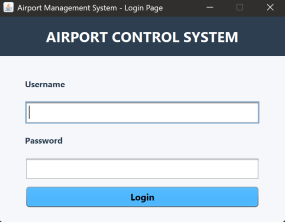
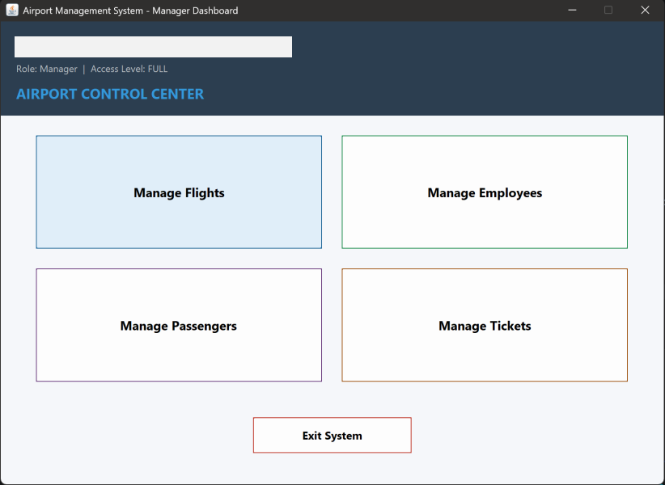
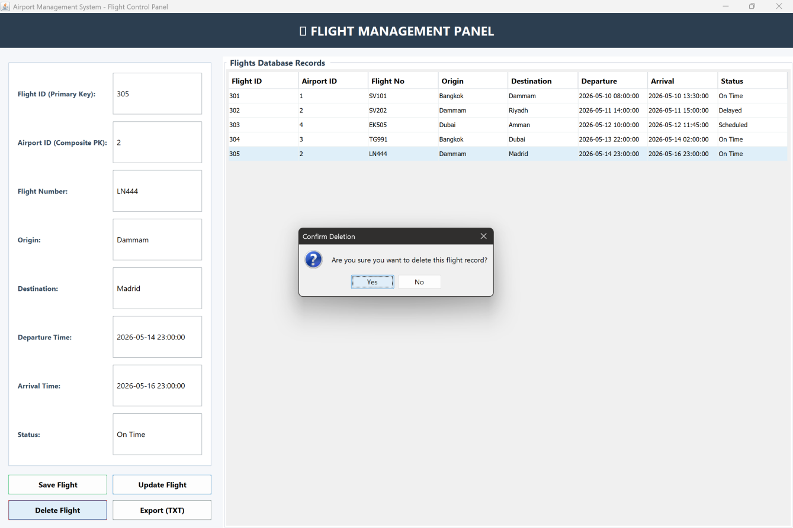
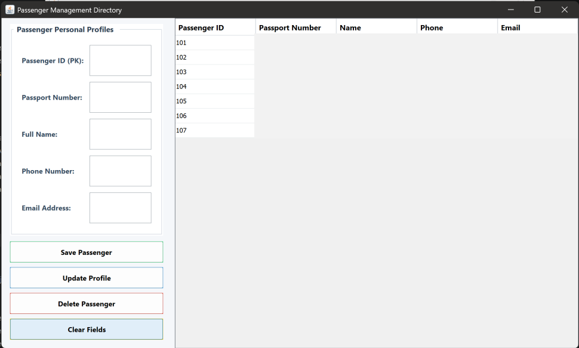
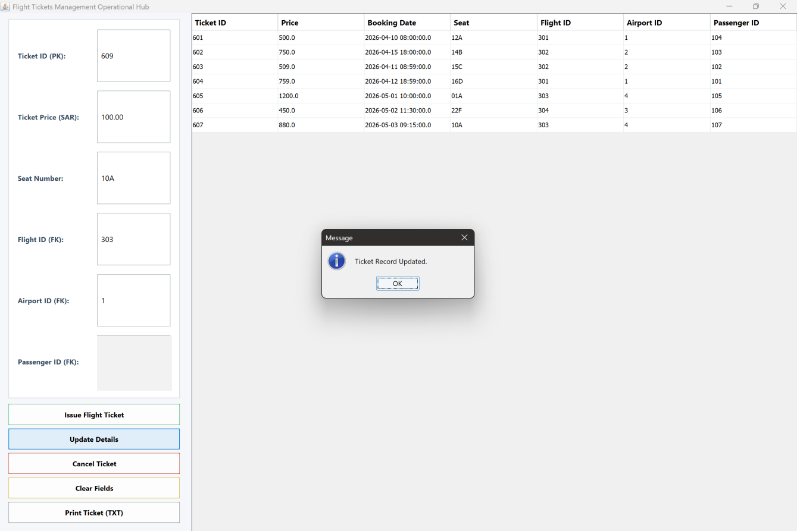
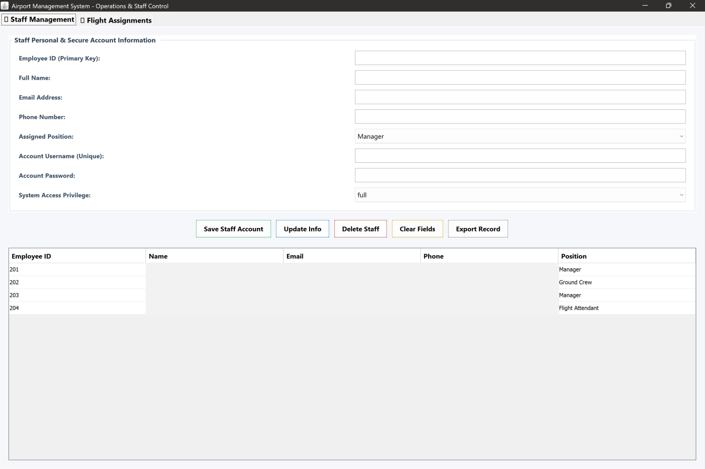
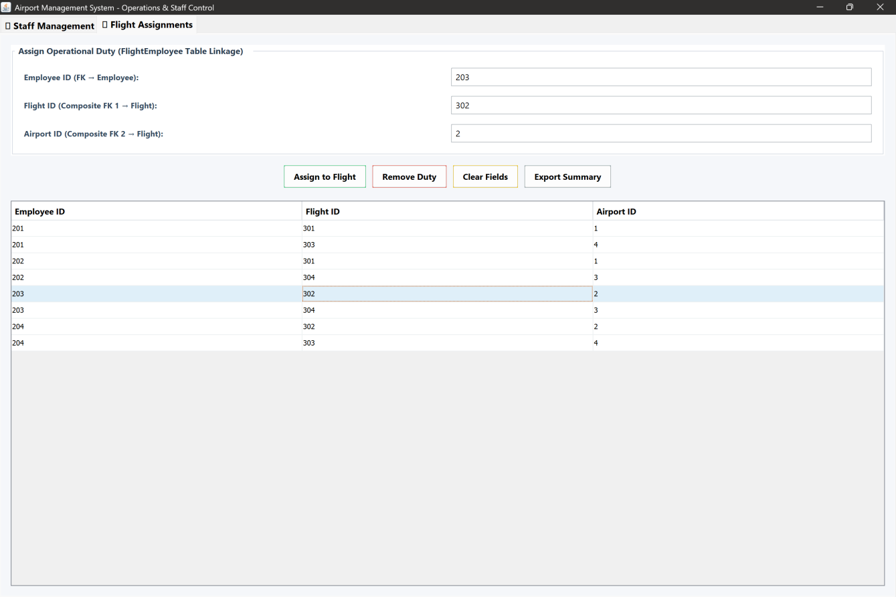

# ✈️ Airport Management System

A desktop-based **Airport Management System** developed using **Java Swing and MySQL** to manage airport operations through an organized graphical interface.

## Features

- **Login System:** Role-based access for managers and staff.
- **Dashboard:** Access to airport management operations.
- **Flight Management:** Add, update, delete, view, and export flight records.
- **Passenger Management:** Manage passenger details and records.
- **Ticket Management:** Manage flight tickets and booking information.
- **Staff Management:** Manage staff accounts, roles, and access levels.
- **Flight Assignments:** Assign employees to flights.
- **Database Integration:** Manage data using MySQL and JDBC.

## Technologies Used

- Java
- Java Swing
- MySQL
- JDBC
- Object-Oriented Programming (OOP)
- Apache NetBeans

## Application Screenshots

### Login Page

### Dashboard

### Flight Management

### Passenger Management

### Ticket Management

### Staff Management

### Flight Assignments

## Team Members

- Munyah Bedah Alhajri
- Rahma Hayyan Araki
- Rawan Omar Alghamdi
- Aseel Ehab Alashqar
- Reema Fayez Almutairi
